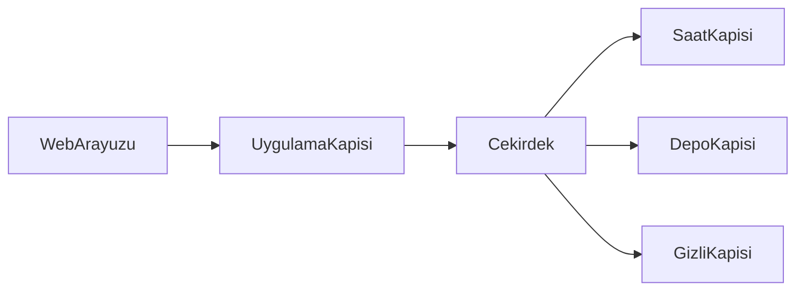
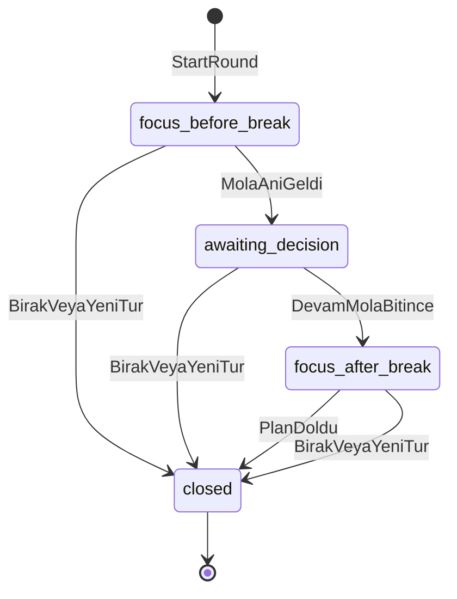
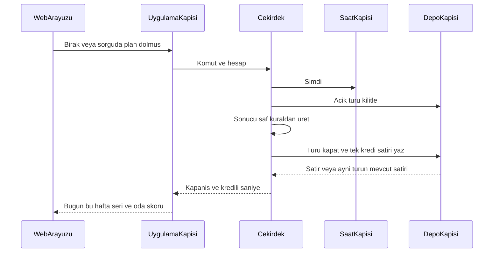
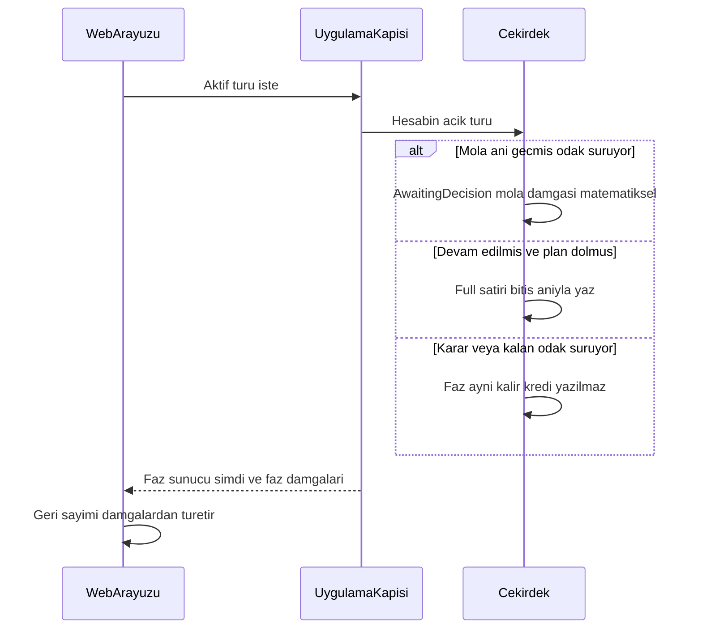
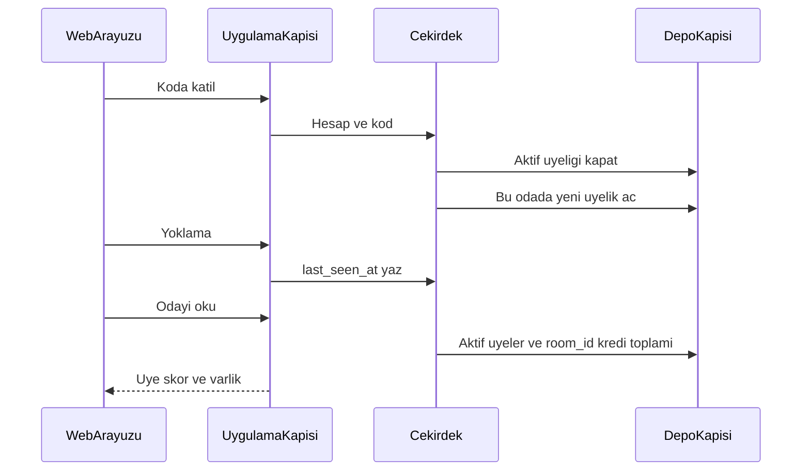

# Sistem tasarımı — Pomodoro ve Odak Zamanlayıcı

Bu belge MVP’nin mühendislik planıdır. Teknoloji seçmez. `docs/mvp-scope.md` dışına çıkılmaz.

Korunan karar: krediyi sunucu, bir kez ve matematiksel zaman damgasıyla yazar. Arayüz süreyi gösterir, süreyi ölçmez. Bugün, bu hafta, seri ve oda sıralaması aynı kredi satırını okur.

## 1. Mimari sınır

Çekirdek altıgen bir çekirdektir. İş kuralları saat, depo ve taşıma protokolü bilmez. Dış dünya kapılardan girer.

| Parça | Görevi | Bilmediği şey |
| --- | --- | --- |
| Web arayüzü | Sunucu anlık görüntüsünden geri sayım türetir. Başlat, devam, bırak, oda ve yoklama niyetlerini gönderir. | Kredi formülü, dönem sınırı, yetki |
| Uygulama kapısı | Oturumu çözer, komut ve sorguyu çekirdeğe taşır, sonucu döner. | Ekran yerleşimi |
| Çekirdek | Tur makinesi, kredi kuralı, dönem ve seri hesabı, oda üyeliği. | HTTP, tablo, şifre algoritması |
| Saat kapısı | Sunucunun `şimdi` değerini verir. | Turun anlamı |
| Depo kapısı | Hesap, tur, kredi satırı, oda ve üyeliği kalıcı kılar. | Kredi matematiği |
| Gizli kapısı | Şifreyi tek yönlü yavaş özetler. Oturum taşıyıcısını üretir ve çözer. | İş kuralı |

İkinci bir platform yazılana kadar çekirdek sunucunun içindedir. Ortak kütüphane o gün, aynı kapılar bozulmadan ayrılır. İstemci kredi kuralının ikinci kopyasını taşımaz.

Arka planda tur kapatan bir işçisi yoktur. Gecikmiş geçiş, o turun sahibi bir komut veya sorgu gönderdiğinde uygulanır. Kapanış damgası isteğin geliş saati değil, kuralın ürettiği matematiksel andır.

## 2. Mantıksal veri modeli

Süre birimi saniyedir. Ekran dakika gösterebilir. Dönem sınırı `Europe/Istanbul` takvimidir. Hafta pazartesi 00:00’da başlar.

### Hesap

- `account_id`
- `email`, tekil
- `password_hash`
- `timezone`, kayıtta `Europe/Istanbul`, değişmez
- `created_at`

### Tur

Kullanıcı başına en çok bir açık tur. Bu kısıt depoda zorlanır.

- `round_id`
- `account_id`
- `planned_seconds`, 15 ile 180 dakika arasındaki tam dakikanın saniye karşılığı
- `break_after_seconds`, başlangıçta `floor(planned_seconds * 2 / 3)`
- `break_length_seconds`, mola açılınca 300 veya 900
- `phase`: `focus_before_break`, `awaiting_decision`, `focus_after_break`, `closed`
- `started_at`
- `break_started_at`, `resumed_at`, `closed_at`
- `outcome`: boş, `abandoned`, `half`, `full`

Mola başlangıcı `started_at + break_after_seconds` anıdır. Geç gelen istek bu anı ötelemez. `break_after_seconds >= 2700` ise mola 900 saniye, değilse 300 saniyedir.

### Kredi satırı

Eklenir, güncellenmez, silinmez. Tur başına en çok bir satır.

- `entry_id`
- `round_id`, tekil
- `account_id`
- `credited_seconds`
- `outcome`
- `closed_at`, matematiksel kapanış anı
- `room_id`, kapanışta aktif üyelik varsa o oda, yoksa boş

Bugün, bu hafta ve seri ayrı sayaç değildir. Bu satırların dönem toplamıdır. Aynı tur ikinci satır üretemez.

### Oda ve üyelik

- Oda: `room_id`, `code`, `host_account_id`, `created_at`
- Kod en az 128 bit entropi taşır ve tahmin edilemez
- Üyelik: `room_id`, `account_id`, `joined_at`, `left_at`, `last_seen_at`
- Hesap başına en çok bir aktif üyelik (`left_at` boş)

Oda skoru, aktif üyelerin bu `room_id` ile yazılmış kredi satırlarının toplamıdır. Ayrılan hesap listeden düşer. Kişisel satırlar durur. Aynı odaya geri gelince eski oda satırları skora yeniden girer.

## 3. Tur makinesi

| Geçiş | Koşul | Satır |
| --- | --- | --- |
| Mola anı geldi | `şimdi >= started_at + break_after_seconds` | Yazılmaz. Faz `awaiting_decision` olur. `break_started_at` matematiksel molladır. |
| Devam | Faz `awaiting_decision` ve `şimdi >= break_started_at + break_length_seconds` | Yazılmaz. `resumed_at = şimdi`. Erken devam reddedilir. |
| Plan doldu | Faz `focus_after_break` ve `şimdi >= resumed_at + (planned_seconds - break_after_seconds)` | `full`, kredili süre `planned_seconds`. `closed_at` bu bitiş anıdır. |
| Bırak veya yeni tur, mola öncesi ya da molada | Faz `focus_before_break` veya `awaiting_decision` | `abandoned`, kredili süre 0. `closed_at = şimdi`. |
| Bırak veya yeni tur, devamdan sonra | Faz `focus_after_break` ve plan henüz dolmadı | `half`. Biriken odak `break_after_seconds + (şimdi - resumed_at)` değeridir, planı aşamaz. Kredili süre bu değerin yarısının aşağı yuvarlanmış halidir. |

Mola saniyesi odak süresine girmez. Kopma ve yenileme, plan dolmadan turu `full` yapmaz. Plan dolduktan sonra gelen ilk sorgu veya komut, zaten dolmuş planı kapatır. Krediyi yenileme değil, dolmuş süre üretir.

`Devam` ve `Bırak` kapalı turda yeniden çalışırsa mevcut satırı döner, ikinci satır yazmaz.

Yeni tur, açık turu yukarıdaki satırla kapatıp ardından açar. Açık tur insan kararı beklerken yeni tur onu 0 yazar. Devam edilmiş ve bitmemiş turu yarım yazar. Planı dolmuş turu tam yazar.

## 4. Kritik akışlar

### 4.1 Tur kapanır, kredi bir kez yazılır

Satır ve turun kapanışı aynı kayıt işleminde biter. İşlem yarıda kalırsa ne satır ne `closed` fazı görünür. İşlem tekrarlanırsa tekil `round_id` mevcut satırı döndürür.

### 4.2 Yenileme ve geç gelen yoklama

Arayüz, görünen sekmede ve mola veya bitiş anına zamanlayarak turu yeniden ister. Aradaki saniyeleri son anlık görüntüden çizer. Çizim krediyi değiştirmez.

İkinci cihaz aynı açık turu okur. Ayrı tur açmaz.

### 4.3 Odaya giriş ve sıralama

Üye, `last_seen_at` son 30 saniye içindeyse odada görünür. Yoklama 10 saniyede bir gelir. Kaçırılan yoklama skoru silmez. Üye listede kalır ve uzakta işaretlenir.

Oda okuması yalnız aktif üyeye açıktır. Bilinmeyen kod ile üyeliksiz okuma aynı reddi döner. Kod, üyelik oluştuktan sonra tek başına okuma anahtarı değildir.

Kredi başka bir kanaldan odaya akmaz. Satır yazılırken `room_id` kopyalanır. Sıralama bu satırların toplamıdır.

## 5. Dönem ve seri

Toplamlar `closed_at` anının İstanbul takvimindeki yerine göre hesaplanır. İsteğin geliş günü kullanılmaz. Gece yarısını aşan geç yoklama, dün biten tam turu bugüne yazmaz.

- Bugün: yerel gece yarısından sonraki gece yarısına kadar, bitiş hariç.
- Bu hafta: pazartesi 00:00’dan sonraki pazartesi 00:00’a kadar, bitiş hariç.
- Seri okuması günleri kredi satırından üretir. Bugünün kredisi varsa seri bugünden geriye sayılır. Bugün henüz boşsa seri dünden geriye sayılır ve gün bitene kadar kopmuş sayılmaz. Gün, kredi yazılmadan biterse seri sıfırdır. Sıfır saniyelik satır günü saydırmaz.

## 6. Kimlik ve yetki

Kayıt, giriş ve oturum aynı uygulamadadır. Her komut, sunucunun çözdüğü hesapla işler. Taşıyıcı olmadan tur, toplam ve oda yoktur.

Şifre düz metin saklanmaz. Özete geri dönülmez. Taşıyıcı ve oda içeriği gizli kanalın dışında dolaşmaz.

Yetki matrisi:

| İş | Kim |
| --- | --- |
| Tur başlat, devam, bırak, kendi özeti | Oturumun hesabı |
| Turu okumak ve kapatmak | Turun sahibi |
| Oda açmak | Oturumun hesabı |
| Koda katılmak | Oturumun hesabı |
| Odayı, skoru ve varlığı okumak | O odanın aktif üyesi |

Uçtan uca şifreleme yoktur. Sunucu krediyi hesaplamak zorundadır. Gizlilik sınırı sahiplik ve üyeliktir.

## 7. İletişim

İstemci ile sunucu istek-yanıttır.

Komutlar: kayıt, giriş, çıkış, tur başlat, devam, bırak, oda aç, koda katıl, odadan ayrıl, yoklama.

Sorgular: aktif tur, özet, oda.

Sürekli kanal, olay kuyruğu ve istemciye özel sorgu dili yoktur. Kredinin yazılması turun kapanışıyla aynı işlemdedir. Ayrı bir tüketicinin skoru geç güncellemesi yoktur.

Komutlar tekrarlanabilir. İkinci kapanış mevcut satırı döner. İkinci katılım, hesabın zaten o odadaki aktif üyeliğini döner.

## 8. Trade-off’lar

| Seçim | Kazanılan | Ödenen |
| --- | --- | --- |
| Sunucu damgası, istemcide yalnızca çizim | Sekme, yenileme ve saat oynatma krediyi şişiremez | Geri sayım, yoklama gecikmesi kadar sıçrayabilir |
| Geçişi istek anında uygulamak | Ayrı işçi ve çift kapanış yolu yok | Kullanıcı hiç dönmezse açık tur, yeni tur komutuna kadar açık kalır. Yeni tur onu kurala göre kapatır |
| Dönem toplamını satırdan hesaplamak | Sayaç ile defter ayrışmaz | Okuma, kullanıcının satır sayısı kadar iş görür. MVP’de bu sayı küçüktür |
| Yoklama, sürekli kanal değil | Kişisel sayaçlar birbirine kilitlenmez | Varlık en fazla yoklama aralığı kadar gecikir. 10 saniye yoklama, 30 saniye varlık penceresi |
| Merkezi oturum | Tek yazarlı defterin tek güven sınırı vardır | Oturum hizmeti durursa tur da durur |
| Kod ile katıl, üyelik ile oku | Katılım kısadır. Sızan kod tek başına odayı açmaz | Kodu gören hesap, katıldığı anda geçmiş oda skorunu da görür |
| Çekirdeği sunucuda tek kopya tutmak | Kural iki istemcide farklılaşmaz | İkinci platform, sunucu hazır olmadan aynı kuralı çalıştıramaz |
| Çevrimdışı kuyruk tutmamak | Çift yazma ve geç kredi yok | Kopukken niyet kaybolur. İstemci bağlantı gelince aynı komutu tekrarlar |
| Erken `Devam`ı reddetmek | 5 ve 15 dakikalık mola gerçek bir aralıktır | Mola uzatılamaz ve kısaltılamaz |

## 9. Bu belgenin bilinçli olarak seçmediği şeyler

Depolama ürünü, uygulama çerçevesi, taşıma kütüphanesi, şifre özeti algoritmasının adı ve arayüz yerleşimi seçilmez. Yerleşim, iletilecek tasarıma göre kurulur. Kapılar ve kredi işlemi değişmeden bu seçimler `docs/tech-stack.md` içinde yapılır.
